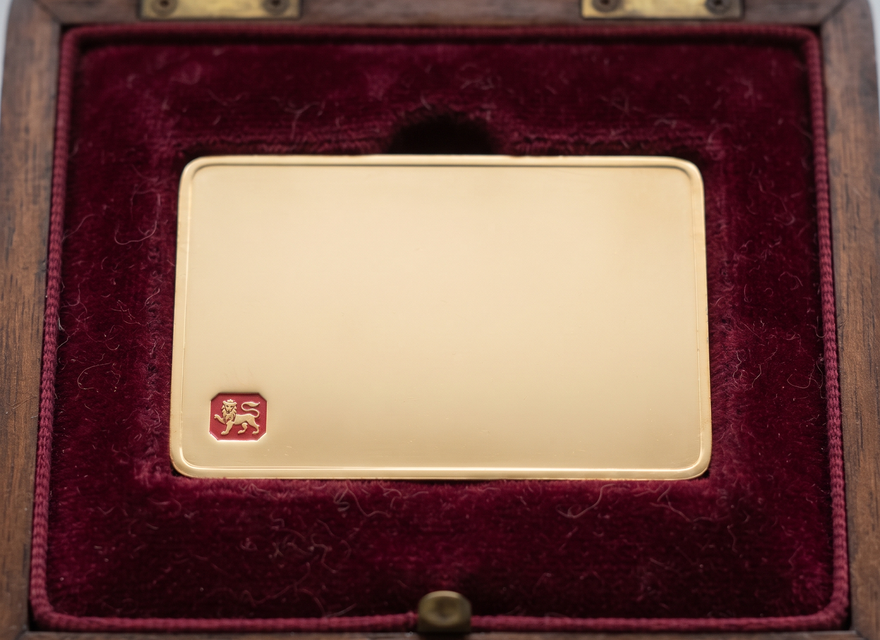
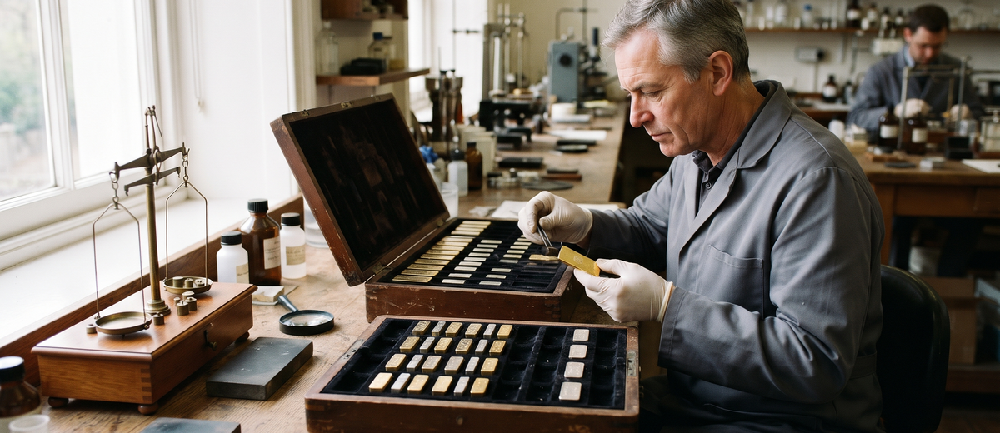

> Medium noted first: gilding, gold leaf on a leather cushion, Caveat Brush in indigo on resist white, a stores list entry.

# cdd-configdrift-BaselineDiff

# cdd-configdrift-BaselineDiff
Compares current configuration against a known good baseline, highlighting differences in a readable format (e.g., using `diff` or similar library). - Focused on This category encompasses tools designed to detect changes in configuration files over time. This allows security teams to identify unauthorized modifications, deviations from established baselines, and potential misconfigurations that could introduce security risks. The tools track and highlight differences across versions, aiding in rapid troubleshooting and remediation.

## Install
`git clone https://github.com/ShadowStrikeHQ/cdd-configdrift-baselinediff`

## Usage
`./cdd-configdrift-baselinediff [params]`

> Leaf book tissue panel: the usage line names neither side of the comparison. It names neither the current configuration nor the baseline it is to be compared with, although comparison between two states is the tool's whole task.

## Parameters
- `-h`: Show help message and exit
- `--format`: No description provided
- `--ignore`: List of keys to ignore in the diff
- `--output`: Path to the output file for the diff. If not specified, diff is printed to stdout.
- `--indent`: No description provided
- `--no-color`: Disable color output.

> Leaf book tissue panel: --format and --indent arrive with no description provided. No meaning is guessed for either of them.

## License
Copyright (c) ShadowStrikeHQ
